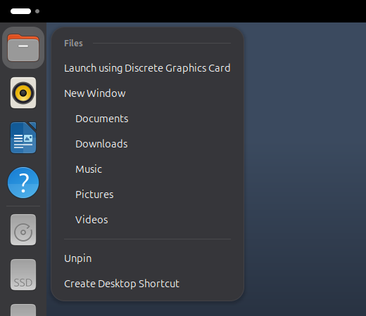

# Wayside

*Formerly Staple. Part of the Sedge family of webhookstudios apps.*

Right-click an app, folder or file and choose **Create Desktop Shortcut**. A shortcut appears on your desktop, and you can drag it wherever you like.



## Where the option appears

| Right-click this | In here |
|---|---|
| An app icon | The dock, the app grid, and the Activities dash |
| A folder or a file | The Files app, including right-clicking the empty space inside a folder to make a shortcut to that folder |

Apps get a copy of their launcher on your desktop, marked as trusted so a double click opens them. Folders and files get a link that shows their own icon. If a shortcut already exists, Wayside tells you instead of making a second one.

Shortcuts are ordinary desktop icons. Move, rename or delete them like any other.

### Dragging a shortcut into a folder

An app shortcut keeps working and keeps its icon when you move it into a folder. The Files app normally shows a plain gear for launcher files inside folders, so Wayside also gives each shortcut its app's icon as a custom icon, which travels with the file. Shortcuts are named after the app, such as `Files.desktop`.

If you move one to a different drive, the launch permission can be lost. Right-click the shortcut and choose **Allow Launching** to turn it back on.

## Requirements

- GNOME Shell 50 (Ubuntu 26.04), on Wayland
- Desktop icons shown on the desktop (Ubuntu's Desktop Icons NG extension, on by default). Without it the shortcuts still land in your Desktop folder.
- `python3-nautilus` for the Files right-click (the deb package pulls it in)

Wayside has only been tested on Ubuntu 26.04 with GNOME Shell 50.1.

## Install

### With the deb package (recommended)

Download `wayside_1.2.0_all.deb` from the [latest release](https://github.com/webhookstudios/wayside/releases/latest), then install it:

```bash
sudo apt install ./wayside_1.2.0_all.deb
```

Log out and back in, then open **Wayside** from the apps menu to turn it on. To remove it:

```bash
sudo apt remove wayside
```

You can also install and update it from [Grove](https://github.com/webhookstudios/grove).

### From source

```bash
git clone https://github.com/webhookstudios/wayside.git
```

```bash
./wayside/install.sh
```

This installs for your user only. For the Files right-click, also run `sudo apt install python3-nautilus`, then `nautilus -q` once.

## Settings

Open **Wayside** from the apps menu, or run:

```bash
gnome-extensions prefs wayside@webhookstudios.github.io
```

| Setting | Default | What it does |
|---|---|---|
| Dock | On | Show the option in the dock's right-click menu |
| App grid and Activities | On | Show the option in those right-click menus |
| Show a message | On | A short note after a shortcut is made |

## Limitations

- The dock part works with Ubuntu Dock and Dash to Dock. Other docks that build their own menus are not supported.
- Right-clicking items already on the desktop does not show the option, since they are already there. Desktop icons are drawn by the desktop extension, which has its own menu.
- Shortcuts to a folder or file are symbolic links. If the original is moved or deleted, the shortcut breaks.

## How it works

For the shell, Wayside adds one menu item to GNOME's app menu class (used by the app grid and the Activities dash) and to the Ubuntu Dock's menu. Creating a shortcut copies the app's `.desktop` file to your Desktop folder, makes it executable and sets `metadata::trusted`. The Files part is a small Python extension in `nautilus/` that makes a symbolic link instead.

| File | Purpose |
|---|---|
| `extension.js` | Adds the menu items to the shell and dock menus |
| `shortcut.js` | Creates an app shortcut |
| `prefs.js` | The settings window |
| `nautilus/wayside_nautilus.py` | The Files right-click for folders and files |

## Development

```bash
ln -s "$PWD/wayside@webhookstudios.github.io" ~/.local/share/gnome-shell/extensions/
```

```bash
glib-compile-schemas wayside@webhookstudios.github.io/schemas
```

A Wayland session cannot reload extension code, so each change needs a logout. Build the release files into `dist/` with `./pack.sh` (extension zip) and `./build-deb.sh` (deb package, needs only `dpkg-deb`).

## License

GPL-2.0-or-later. See [LICENSE](LICENSE).
